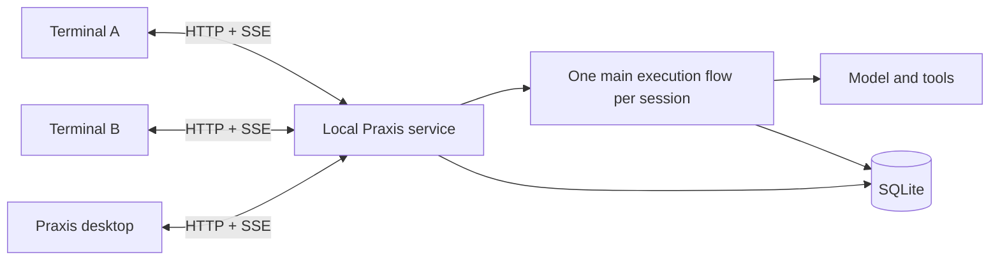

# Praxis

**A local coding agent. One session across your terminals and desktop.**

Praxis helps you explore a codebase, edit files, run commands, and coordinate agents through a persistent conversation. Its Python service owns execution; the terminal and [Praxis-UI desktop app](https://github.com/aldercreek/Praxis-UI) connect to the same sessions. Close a client, open another, and pick up where you left off.

[Get started](#get-started) · [Desktop](#desktop) · [How it works](#how-it-works) · [Reference](docs/reference.md) · [Development](#development)

> Praxis is under active development. Install the backend and desktop client from source together.

## What you can do

- **Work across clients.** View and control a running session from multiple terminals or the desktop without starting competing agent loops.
- **Guide work as it runs.** Send follow-up instructions, approve a tool call, or stop a specific turn. Unconsumed input survives cancellation.
- **Keep your progress.** SQLite stores messages, tool results, approvals, pending input, and ordered events. Reconnecting restores the display without rerunning tools.
- **Use the right tools.** Read and edit files, search with ripgrep, run background commands, discover MCP tools, and load project skills.
- **Delegate focused tasks.** Subagents have their own context and working directory. The parent coordinates their results.
- **Manage long conversations.** Search saved history and compress the model's context while retaining the original records.

## Get started

You need **Python 3.12+** and **[ripgrep](https://github.com/BurntSushi/ripgrep)** available as `rg`. Use `python3` instead of `python` if that is how your system names Python.

```sh
git clone https://github.com/aldercreek/Praxis.git
cd Praxis
python -m venv .venv
```

Activate the environment and install the project:

```powershell
# Windows PowerShell
.\.venv\Scripts\Activate.ps1
python -m pip install -e ".[dev]"
```

```sh
# macOS / Linux
source .venv/bin/activate
python -m pip install -e ".[dev]"
```

Configure a model provider that supports the **Responses API**. Replace all three placeholders with your provider's values:

```powershell
# Windows PowerShell
$env:ADA_API_KEY = "your-api-key"
$env:ADA_BASE_URL = "https://your-provider.example/v1"
$env:ADA_MODEL = "your-model-id"
```

```sh
# macOS / Linux
export ADA_API_KEY="your-api-key"
export ADA_BASE_URL="https://your-provider.example/v1"
export ADA_MODEL="your-model-id"
```

Open your project and start a conversation:

```sh
cd path/to/your/project
praxis
praxis "Explain how this project handles background jobs"
```

The first client starts an independent local service. Later clients discover and reuse it. Environment settings are read by the service at startup; opening a new terminal does not replace the configuration of an existing service.

## Desktop

[Praxis-UI](https://github.com/aldercreek/Praxis-UI) provides a desktop workspace with streaming conversations, tool activity, file changes, document previews, and selection-to-quote input.

```sh
git clone https://github.com/aldercreek/Praxis-UI.git
cd Praxis-UI
npm ci
npm run dev
```

Keep the repositories next to each other, or select your Praxis checkout and Python interpreter in desktop settings. The terminal and desktop share `~/.praxis` by default. Set the same `PRAXIS_DATA_DIR` in both environments to use another data directory.

Connecting to an existing service adopts its current configuration. Explicit model or approval-setting changes are rejected while any session is running.

## Everyday use

```sh
praxis --sessions                    # List sessions in this workspace
praxis --continue                    # Continue the latest session
praxis --continue "Focus on tests"   # Continue with an instruction
praxis --resume a3f21c8d              # Full session ID or unique prefix
```

| Action | Terminal control |
| --- | --- |
| Send an instruction or follow-up | Enter |
| Stop the current turn | Esc |
| Resume retained input | Ctrl+R |
| Edit pending input | Shift+Left |
| Inspect the full transcript or tool parameters | Ctrl+T |
| Switch between agent views | Alt+Left / Alt+Right |
| Approve / deny a tool call | y / n in the approval panel |
| Start a new session | `/clear` while idle |
| Inspect / stop a background command | `/commands` / `/stop-command ID` |
| Disconnect the terminal | `/exit` or Ctrl+Q |

Closing the terminal or desktop **does not cancel its tasks**. Use the stop control to cancel a turn. Cancellation waits for owned work to finish cleaning up, then leaves unconsumed input available to resume, edit, or delete.

`praxis --bypass` enables approval bypass for the shared service when no turns are active. It affects all connected clients and lasts until changed or the service exits; parameter validation still applies.

## How it works



**One owner.** The service acquires an operating-system lock before opening the database or recovering turns. It listens on a dynamically allocated `127.0.0.1` port and publishes its registration only when ready. Clients validate its identity, protocol version, readiness, and local bearer token. A client disconnect never releases service ownership.

**Durable input.** Each submission carries a client-generated `command_id`. A SQLite transaction saves the command, input, and reply together. A retry with the same ID returns the original result; reusing that ID with different content returns a conflict. Input joins the active turn at a model boundary, or starts a new turn when the session is idle.

**Ordered updates.** Each session has a durable, increasing event sequence. A client subscribes before loading a snapshot, buffers incoming events, and applies only those after the snapshot's sequence. Each SSE connection reads replayed and live events through one ordered database loop. Heartbeats detect stale connections; reconnects start after the last event successfully applied by the client.

**Saved history.** Snapshots also restore finished turns saved in the conversation tables before an event journal existed. Both clients receive their messages and tool results in turn order. This display reconstruction does not execute an agent, rewrite history, or change the SSE cursor.

**Explicit outcomes.** Turns use `running`, `completed`, `cancelled`, or `failed`. A cancellation names its turn, so a delayed request cannot stop a newer turn. The first valid approval decision wins. On service restart, unfinished turns become failed, pending approvals close, and unknown tool outcomes are recorded without automatic retries.

Session events currently remain in SQLite without retention cleanup. Subagent processes, background commands, and Monty variables are not restored after service restart. See the [reference](docs/reference.md) for execution boundaries and configuration.

## Local service

| File in the data directory | Purpose |
| --- | --- |
| `state.sqlite3` | Sessions, commands, inputs, tool records, approvals, and events |
| `service.lock` | Exclusive service ownership for this data directory |
| `service.json` | PID, port, instance ID, and protocol version |
| `service.token` | Local HTTP authentication token |
| `service.log` | Background-service diagnostics |

```sh
python -m praxis_agent.service --ensure                 # Discover/start; print registration without its token
python -m praxis_agent.service --data-dir ./local-state # Run in the foreground for development
```

A process that is unresponsive but still holds the lock is not automatically replaced. Inspect `service.log` when startup fails. Keep service data and credentials outside Git.

## Development

```sh
python -m pytest -q
python -m pytest tests/service -q
```

The service tests use real HTTP/SSE connections and SQLite with deterministic model substitutes. They cover competing launchers, concurrent submission, approvals, cancellation cleanup, snapshot boundaries, replay, and recovery. Terminal layout tests share a lightweight client fixture. Tests do not call a live model or external MCP server.

| Area | Responsibility |
| --- | --- |
| `service/` | Discovery, HTTP, session scheduling, input admission, approvals, event journal |
| `sessions/` | Database transactions, schema, conversation storage, serialization |
| `agent.py`, `agent_loop.py`, `factory.py` | Turn lifecycle, model/tool loop, dependency construction |
| `client.py`, `terminal/` | HTTP/SSE client, terminal connection state, presentation |
| `tools/`, `multi_agent/` | Local tools, process ownership, agent collaboration |
| `context/`, `planning/` | History views, context budgets, plans, run state |

For changes, keep execution ownership in the service and add regression coverage at the relevant boundary. Report a reproducible problem in [GitHub Issues](https://github.com/aldercreek/Praxis/issues), omitting credentials and private session data.
