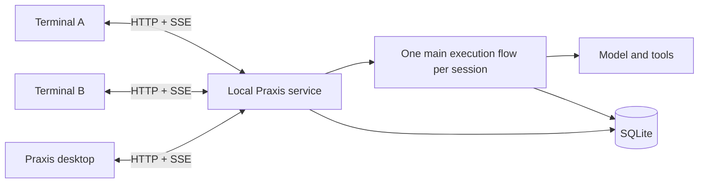

<h1 align="center">Praxis</h1>

**A local coding agent. One session across your terminals and desktop.**

Praxis helps you explore a codebase, edit files, run commands, and coordinate agents through a persistent conversation. Its Python service owns execution; the terminal and [Praxis-UI desktop app](https://github.com/aldercreek/Praxis-UI) connect to the same sessions. Close a client, open another, and pick up where you left off.

[Get started](#get-started) · [Agent collaboration](#agent-collaboration) · [Desktop](#desktop) · [Reference](docs/reference.md) · [Development](#development)

> **Source preview.** Install the backend and desktop from matching revisions. This version uses database schema 6 and does not migrate older databases. Choose a new `PRAXIS_DATA_DIR` to start fresh; existing data is not automatically deleted.

## What you can do

- **Work across clients.** View and control a running session from multiple terminals or the desktop without starting competing agent loops.
- **Guide work as it runs.** Send follow-up instructions, approve a tool call, or stop a specific turn. Unconsumed input survives cancellation.
- **Keep your progress.** SQLite stores messages, tool results, approvals, pending input, and ordered events. Reconnecting restores the display without rerunning tools.
- **Use the right tools.** Read and edit files, search with ripgrep, run background commands, discover MCP tools, and load project skills.
- **Add your own tools.** Enable independent Python files with `@tool`, Pydantic-backed typed parameters and dataclasses. See [Python tool extensions](docs/tool-extensions.md). Control calls and transform results with [tool hooks](docs/tool-hooks.md).
- **Delegate focused tasks.** Subagents have their own context and working directory. The parent coordinates their results.
- **Manage long conversations.** Search saved history and compress the model's context while retaining the original records.

## Directory instructions

Praxis reads `~/.praxis/AGENTS.md` when creating an agent, including subagents and
restored sessions. These user-wide defaults stay in its fixed context and count
toward the context budget. Changes apply to newly created agents; existing agents
keep their startup snapshot. Missing or empty files are ignored; unreadable files
produce an error rather than silently dropping instructions.

For task-specific instructions, the agent uses its existing file and command tools
to find `AGENTS.md` in the actual target directory and its ancestors up to the
filesystem root. This works outside Git repositories and independently of the
startup directory. Instructions apply to their directory and descendants; deeper
instructions take precedence on conflicts, and explicit user requests take precedence
over file instructions. The agent checks new directories as needed and rereads rules
that have changed or are no longer available in context. This discovery is guided by
the prompt, not enforced by a filesystem interceptor.

## Agent collaboration

Give the main agent an objective and clear boundaries. For example:

> Implement the API change and update its tests. Delegate an independent review of the error cases. Have the implementation and review agents exchange findings, then run the relevant checks and summarize unresolved risks.

The runtime supplies each agent with the current team: IDs, responsibilities, capabilities and status. Members can address each other without asking the parent to relay every message. Creating, closing or reassigning an agent updates that context on the next model request.

| Capability | How it works |
| --- | --- |
| Focused delegation | `spawn_agent` starts a worker with an explicit task and a separately prepared working directory. |
| Optional inherited context | `inherit_context=true` copies the parent's retained conversation as background. The new task defines the worker's scope. |
| Direct communication | The parent uses `send_messages`; workers use `send_message` to reach the parent or a live peer. |
| Responsive waiting | `wait_agents(timeout=60)` wakes for mail, team changes, parent user input, timeout or closure. It takes no agent-ID filter. |
| Explicit closure | `close_agent` requests cancellation and releases the worker's context after execution stops. |

**A wake is not “all agents finished.”** An idle recipient resumes when messaged; a busy recipient receives messages at a model boundary. Ordinary streaming tokens do not wake a wait.

Inherited context does not include hidden originals removed by compaction, future user input, Python variables or command sessions. Worker directories are not automatically copied, synchronized or merged. Worker waits currently occupy worker-pool threads.

## Get started

You need **Python 3.12+** and **[ripgrep](https://github.com/BurntSushi/ripgrep)** available as `rg`. Use `python3` instead of `python` if that is how your system names Python.

```sh
git clone https://github.com/aldercreek/Praxis.git
cd Praxis
python -m venv .venv
```

Activate the environment and install the project:

```powershell
# Windows PowerShell
.\.venv\Scripts\Activate.ps1
python -m pip install -e ".[dev]"
```

```sh
# macOS / Linux
source .venv/bin/activate
python -m pip install -e ".[dev]"
```

Create `~/.praxis/praxis.yaml` (or pass `praxis --config /absolute/path/praxis.yaml`). A configuration file is required; Praxis has no built-in providers, model catalog, or model-name inference.

```yaml
models:
  coding:
    protocol: responses  # or chat_completions
    base_url: https://your-provider.example/v1
    model: your-model-id
    api_key_env: MODEL_API_KEY
    context_window: 128000
    max_output_tokens: 8192
```

Set the environment variable named by `api_key_env` before starting the service. Omit that field for an endpoint without authentication. Credentials never belong in the YAML file.

```powershell
$env:MODEL_API_KEY = "your-api-key"
```

```sh
export MODEL_API_KEY="your-api-key"
```

See [model configuration](docs/configuration.md) for multiple models, compression, workers, and all defaults.

Open your project and start a conversation:

```sh
cd path/to/your/project
praxis
praxis "Explain how this project handles background jobs"
```

The first client starts an independent local service. Later clients discover and reuse it. The service loads its configuration file at startup. `--config` explicitly reloads the shared service configuration when no turns are active; editing a file alone does not change a running agent. Credentials are read from the service process environment.

## Desktop

[Praxis-UI](https://github.com/aldercreek/Praxis-UI) provides a desktop workspace with streaming conversations, tool activity, file changes, document previews, and selection-to-quote input.

```sh
git clone https://github.com/aldercreek/Praxis-UI.git
cd Praxis-UI
npm ci
npm run dev
```

Keep the repositories next to each other, or select your Praxis checkout and Python interpreter in desktop settings. The terminal and desktop share `~/.praxis` by default. Set the same `PRAXIS_DATA_DIR` in both environments to use another data directory.

Connecting to an existing service adopts its current configuration. Explicit model or approval-setting changes are rejected while any session is running.

## Everyday use

```sh
praxis --sessions                    # List sessions in this workspace
praxis --continue                    # Continue the latest session
praxis --continue "Focus on tests"   # Continue with an instruction
praxis --resume a3f21c8d              # Full session ID or unique prefix
```

| Action | Terminal control |
| --- | --- |
| Send an instruction or follow-up | Enter |
| Stop the current turn | Esc |
| Resume retained input | Ctrl+R |
| Edit pending input | Shift+Left |
| Inspect the full transcript or tool parameters | Ctrl+T |
| Switch between agent views | Alt+Left / Alt+Right |
| Approve / deny a tool call | y / n in the approval panel |
| Start a new session | `/clear` while idle |
| Delete the current session | `/delete`, then confirm |
| Inspect / stop a background command | `/commands` / `/stop-command ID` |
| View MCP service status | `/mcp` |
| View Python tool extensions | `/tools` |
| View tool hooks and execution order | `/hooks` |
| Disconnect the terminal | `/exit` or Ctrl+Q |

Closing the terminal or desktop **does not cancel its tasks**. Use the stop control to cancel a turn. Cancellation waits for owned work to finish cleaning up, then leaves unconsumed input available to resume, edit, or delete.

Deleting a session closes it to new input and approvals, stops its running tasks and background commands, and removes its conversation history. Workspace files are preserved. Other connected clients remove the session too. Deletion intent is saved in SQLite before cleanup; if the service exits midway, the next startup finishes cleanup in the background without restoring that session's Agent.

`praxis --bypass` enables approval bypass for the shared service when no turns are active. It affects all connected clients and lasts until changed or the service exits; parameter validation still applies.

## How it works



**One owner.** The service acquires an operating-system lock before opening the database or recovering turns. It listens on a dynamically allocated `127.0.0.1` port and publishes its registration only when ready. Clients validate its identity, protocol version, readiness, and local bearer token. A client disconnect never releases service ownership.

**Durable input.** Each submission carries a client-generated `command_id`. A SQLite transaction saves the command, input, and reply together. A retry with the same ID returns the original result; reusing that ID with different content returns a conflict. Input joins the active turn at a model boundary, or starts a new turn when the session is idle.

**Ordered updates.** Each session has a durable, increasing event sequence. A client subscribes before loading a snapshot, buffers incoming events, and applies only those after the snapshot's sequence. Each SSE connection reads replayed and live events through one ordered database loop. Heartbeats detect stale connections; reconnects start after the last event successfully applied by the client.

**One display history.** Snapshots replay the current event journal for both clients. There is no reconstruction of old unjournaled records, database migration, or old tool-protocol adapter. Reopening a current session does not execute an agent or change the SSE cursor.

**Explicit outcomes.** Turns use `running`, `completed`, `cancelled`, or `failed`. A cancellation names its turn, so a delayed request cannot stop a newer turn. The first valid approval decision wins. On service restart, unfinished turns become failed, pending approvals close, and unknown tool outcomes are recorded without automatic retries.

Session events currently remain in SQLite without retention cleanup. Subagent processes, background commands, and CPython variables are not restored after service restart. See the [reference](docs/reference.md) for execution boundaries and configuration.

## Local service

| File in the data directory | Purpose |
| --- | --- |
| `state.sqlite3` | Sessions, commands, inputs, tool records, approvals, and events |
| `service.lock` | Exclusive service ownership for this data directory |
| `service.json` | PID, port, instance ID, and protocol version |
| `service.token` | Local HTTP authentication token |
| `service.log` | Background-service diagnostics |
| `mcp.json` | Shared MCP server configuration |

The service starts enabled MCP servers in the background, with at most eight connection attempts in progress. Each server gets up to three attempts, with one- and two-second retry delays. Startup does not wait for MCP connections. Successful connections are shared by all agents; newly available services appear on their next model request. Tool activation and approvals stay local to each agent. Use `/mcp` in the terminal or desktop to see service names and connection states. Tool execution is never automatically retried.

```sh
python -m praxis_agent.service --ensure                 # Discover/start; print registration without its token
python -m praxis_agent.service --data-dir ./local-state # Run in the foreground for development
```

A process that is unresponsive but still holds the lock is not automatically replaced. Inspect `service.log` when startup fails. Keep service data and credentials outside Git.

## Development

```sh
python -m pytest -q
python -m pytest tests/service -q
```

The service tests use real HTTP/SSE connections and SQLite with deterministic model substitutes. They cover competing launchers, concurrent submission, approvals, cancellation cleanup, snapshot boundaries, replay, and recovery. Terminal layout tests share a lightweight client fixture. Tests do not call a live model or external MCP server.

| Area | Responsibility |
| --- | --- |
| `service/` | Discovery, HTTP, session scheduling, input admission, approvals, event journal |
| `sessions/` | Database transactions, schema, conversation storage, serialization |
| `agent.py`, `agent_loop.py`, `factory.py` | Turn lifecycle, model/tool loop, dependency construction |
| `client.py`, `terminal/` | HTTP/SSE client, terminal connection state, presentation |
| `tools/`, `multi_agent/` | Local tools, process ownership, agent collaboration |
| `context/`, `planning/` | History views, context budgets, plans, run state |

For changes, keep execution ownership in the service and add regression coverage at the relevant boundary. Report a reproducible problem in [GitHub Issues](https://github.com/aldercreek/Praxis/issues), omitting credentials and private session data.
